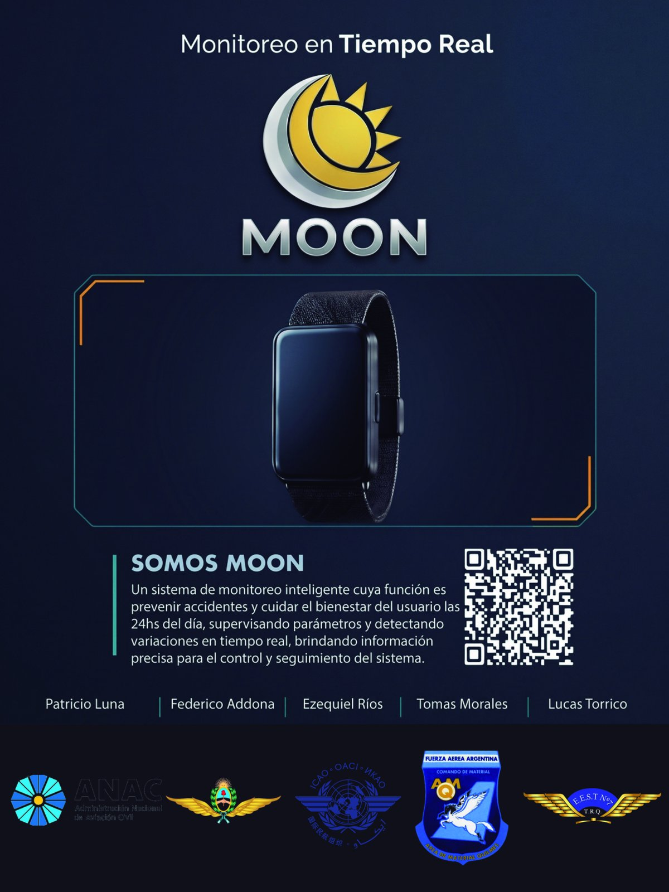
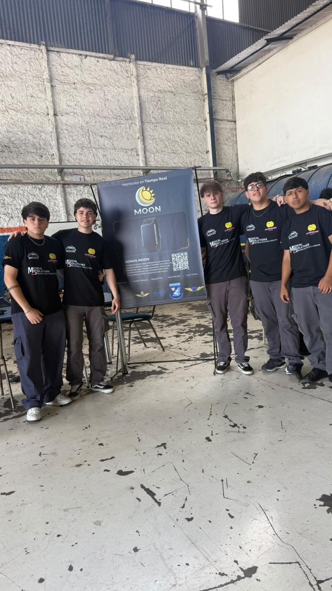
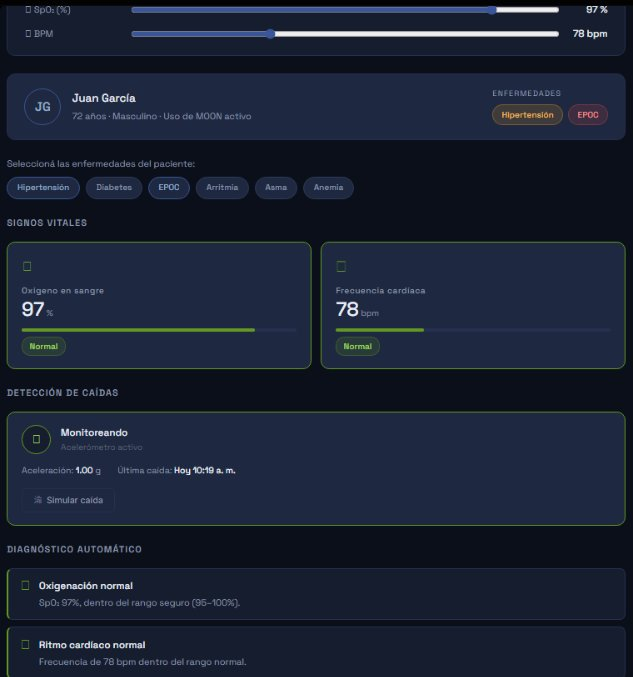
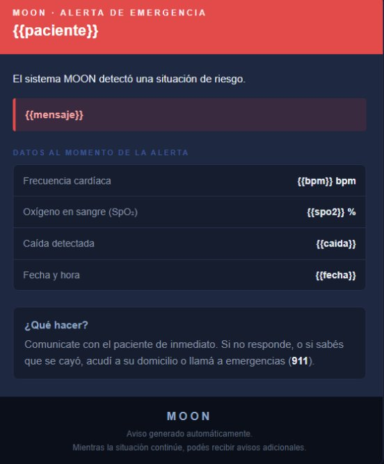
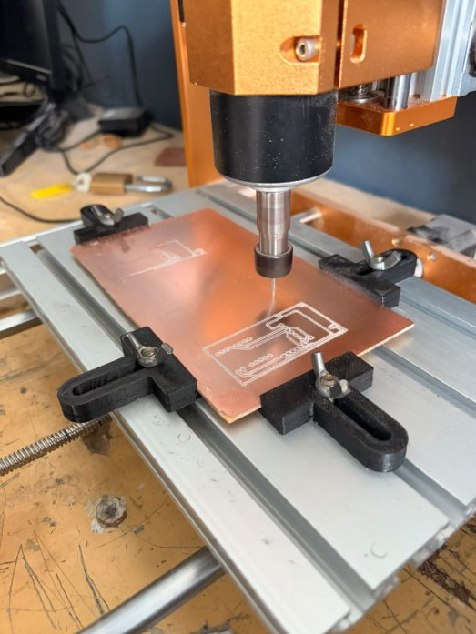
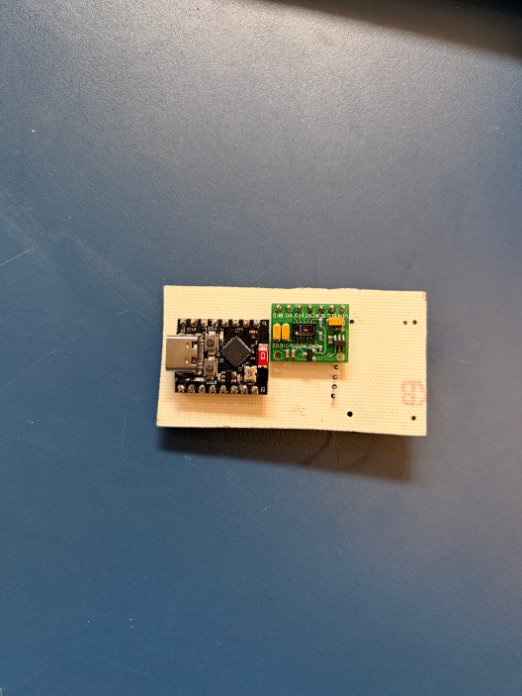
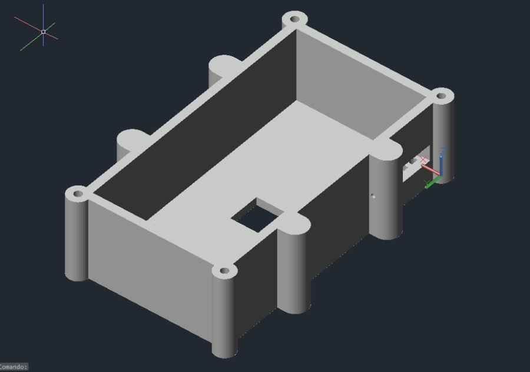
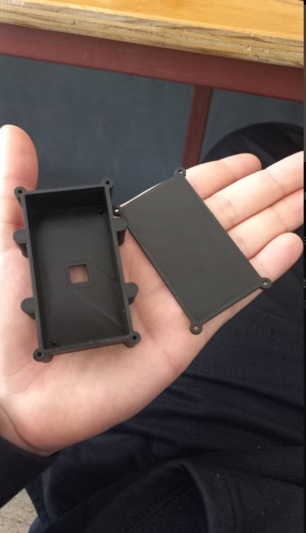
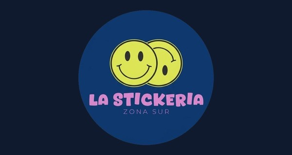
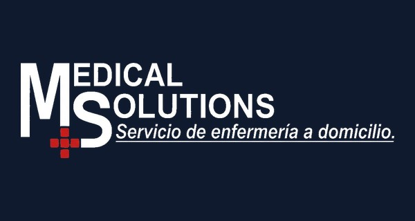

# MOON: la pulsera que cuida cuando nadie está mirando

<table align="center">
<tr>
<td align="center">

</td>
<td align="center">

</td>
</tr>
</table>

Proyecto de Prácticas Profesionalizantes de la **E.E.S.T. N.º 7 TRQ "IMPA" — Taller Regional Quilmes**, especialidad **Aviónica**. 7°1 Aviónica, Comisión C — 2026.

## Video de Presentación:

<a href="https://www.youtube.com/watch?v=26mkhNtAuPY">Video de Presentación</a>

## Acceso a página web:

<a href="https://proyectomoon.github.io/Web/">Web Page</a>

- Panel del paciente: <a href="https://proyectomoon.github.io/Paciente/">proyectomoon.github.io/Paciente</a>
- Simulador de prueba: <a href="https://proyectomoon.github.io/TestPaciente/">proyectomoon.github.io/TestPaciente</a>

## El problema:

Mucha gente pasa horas sola: adultos mayores, personas con discapacidad, gente que trabaja sin compañía. Si se caen o se sienten mal, a veces nadie se entera a tiempo. Y en una emergencia, unos minutos pueden hacer toda la diferencia.

## Objetivo del Proyecto:

MOON es una pulsera que se usa como un reloj y hace tres cosas:

- **Detecta caídas sola**, sin que la persona tenga que hacer nada.
- **Controla el pulso y el oxígeno en sangre** todo el tiempo.
- **Avisa al instante** a un familiar o contacto de emergencia si algo anda mal.

La idea es ir un paso más allá de un reloj que solo muestra valores: MOON es una herramienta de **prevención y seguimiento**. Mide, transmite, muestra y alerta, para que una persona responsable pueda actuar antes de que un problema avance o pase desapercibido.

## ¿De dónde surgió la idea?

La idea surgió al pensar en un problema muy común: las caídas de las personas mayores. Muchos adultos mayores viven solos o pasan gran parte del día sin compañía, y una caída puede dejarlos en el piso sin poder levantarse ni pedir ayuda. Cuanto más tiempo pasa hasta que alguien se entera, más graves pueden ser las consecuencias.

Nos preguntamos cómo podíamos usar lo que aprendemos en la escuela para que una caída no pase desapercibida. Así nació MOON: una pulsera que detecta la caída sola y le avisa enseguida a un familiar, sin que la persona tenga que hacer nada. Después sumamos el control del pulso y del oxígeno en sangre, para poder detectar también otras situaciones de riesgo.

## ¿Por qué adultos mayores?

Una persona mayor puede estar sola, tener dificultades para avisar que necesita ayuda o presentar cambios en su cuerpo que conviene vigilar. MOON funciona como una capa extra de acompañamiento: un familiar o cuidador puede ver cómo está sin tener que estar al lado todo el tiempo.

> MOON no reemplaza a un médico, a un cuidador ni a un instrumento médico profesional. Qué hacer ante una alerta siempre lo decide la persona responsable y, cuando corresponde, los profesionales de la salud.

## Descripción del proyecto:

Juntamos sensores chicos y económicos en un dispositivo liviano, con batería recargable por USB tipo C, como un celular. La pulsera analiza lo que mide y, si detecta algo raro, manda la alerta.

El recorrido de MOON es así:

**usuario lleva la pulsera → los sensores miden → el ESP32-C3 procesa los datos → se envían por Bluetooth → la página web los muestra → el sistema detecta una situación de riesgo → se genera una alerta → un responsable interviene.**

El cerebro de la pulsera es un **ESP32-C3 SuperMini**, que lee los datos del **MAX30102** (frecuencia cardíaca y saturación de oxígeno, medidos con luz roja e infrarroja) y del **MPU6050** (acelerómetro y giroscopio que detecta movimientos bruscos para identificar caídas). Los datos viajan por **Bluetooth** hasta la página de pacientes, que tiene reconexión automática si la pulsera se desconecta.

En la página web del paciente se puede:

- Registrar al paciente y cargar su perfil (nombre, edad, género, enfermedades preexistentes).
- Elegir a qué mail y a qué canal de ntfy llegan las alertas.
- Ver en vivo el pulso, el oxígeno y las caídas, con rangos normal / irregular / crítico.
- Responder ante una caída: "Estoy bien" o pedir ayuda a un familiar.
- Ver un diagnóstico automático a partir de los datos y del perfil.

## Sistema de alertas:

Cuando MOON detecta una caída o un valor crítico de pulso u oxígeno, avisa de dos formas:

**1. Alerta por mail**

Al registrar al paciente se elige el mail al que llegan los avisos (por ejemplo, el de un familiar). Cuando hay una emergencia, llega un correo con:

- El nombre del paciente y qué pasó.
- La frecuencia cardíaca, el oxígeno en sangre y si se detectó una caída.
- La fecha y hora del aviso.
- Qué hacer: comunicarse con el paciente y, si no responde, ir a su casa o llamar a emergencias.

Entre un mail y otro hay un tiempo de espera, para no llenar la casilla de avisos repetidos.

**2. Alerta por ntfy**

[ntfy](https://ntfy.sh) es una app gratuita para el celular (Android y iPhone) que recibe notificaciones al instante. Funciona así:

1. El familiar se instala la app ntfy en el celular.
2. Se suscribe al canal (tema) que se cargó en el perfil del paciente.
3. Cuando MOON detecta una emergencia, le llega una notificación al celular al momento, aunque no tenga la página abierta.

<table align="center">
<tr>
<td align="center"> Panel del paciente</td>
<td align="center"> Alerta por mail</td>
</tr>
</table>

## Componentes a utilizar:

| Componentes        | Función                                                                                      |
| ------------------ | -------------------------------------------------------------------------------------------- |
| ESP32-C3 SuperMini | Microcontrolador principal: lee los sensores, decide y manda los datos por Bluetooth/Wi-Fi.  |
| MAX30102           | Mide frecuencia cardíaca y saturación de oxígeno con luz roja e infrarroja.                  |
| MPU6050            | Acelerómetro y giroscopio: detecta movimientos bruscos en X, Y y Z para identificar caídas.  |
| Batería Li-Po      | Alimentación liviana y recargable.                                                           |
| TP4056             | Carga por USB tipo C y protección contra sobrecargas.                                        |
| Switch             | Encendido y apagado de la pulsera.                                                           |

## Instalación y Uso

MOON viene lista para usar, no hace falta instalar ni programar nada.

1. Ponerse la pulsera en la muñeca.
2. Prenderla con el switch.
3. Entrar al [panel del paciente](https://proyectomoon.github.io/Paciente/) desde **Chrome o Edge** y completar el perfil, con el mail y el canal de ntfy donde van a llegar las alertas.
4. Tocar **Conectar** para vincular la pulsera por Bluetooth.
5. Listo: la pulsera empieza a medir y avisa sola si pasa algo.

Para cargarla, se conecta por USB tipo C, como un celular.

## Fabricación:

- **Placa:** diseñada en **KiCad** y fabricada en el taller con **CNC**, planchado, ataque con ácido, agujereado y soldadura. Se hicieron varias versiones hasta llegar a una que funcione bien.
- **Carcasa:** diseñada en **AutoCAD** e impresa en **3D**, con tapa atornillada, lugar para la placa, abertura para el sensor y entrada USB tipo C.

<table align="center">
<tr>
<td align="center"> Placa en la CNC</td>
<td align="center"> Placa con componentes</td>
</tr>
<tr>
<td align="center"> Diseño de la carcasa</td>
<td align="center"> Carcasa impresa en 3D</td>
</tr>
</table>

## Desarrollo del proyecto:

| Mes                | Qué se hizo                                                                                                                    |
| ------------------ | ------------------------------------------------------------------------------------------------------------------------------ |
| Abril              | Simulación de la placa (Wokwi y protoboard), primer código, arranque de la página web, Instagram y búsqueda de sponsors.        |
| Junio              | Llegada, soldadura y prueba de componentes. Estudio de baterías y módulo de carga. Sección de pacientes en la web. KiCad.      |
| Julio y agosto     | Códigos del MPU6050 y del MAX30102 y unión de ambos. Sistema de alertas por caída. Esquemático de la placa. Pruebas por Wi-Fi.  |
| Septiembre         | Placa terminada en KiCad y fabricada con CNC. Conexión Bluetooth con la página, primero con valores simulados y después reales. Carcasa en AutoCAD. |
| Octubre            | Nuevas placas, detección de caídas en la web, alertas por mail, nuevo banner, remera, calcos e impresión 3D de la carcasa.      |
| Noviembre          | Revisión y corrección de la placa.                                                                                             |

## Integrantes

| Integrantes          | Responsabilidades                                                                    | Tareas Secundarias                                          |
| -------------------- | ------------------------------------------------------------------------------------ | ----------------------------------------------------------- |
| Morales Tomás        | Programación del firmware: sensores, Bluetooth y unificación de códigos              | Diseño de la placa en KiCad, fabricación con CNC y soldadura |
| Addona Federico      | Desarrollo de la página web, sección de pacientes y alertas por mail                 | Carcasa en AutoCAD, fabricación y soldadura de placas       |
| Luna Patricio        | Diseño de la placa en KiCad y fabricación                                            | Banner, remera e impresión 3D de la carcasa                 |
| Ríos Cabral Ezequiel | Difusión, redes sociales y búsqueda de sponsors                                      | Esquemático en KiCad, módulo de carga y diseño de carcasa   |
| Torrico Lucas        | Sistema de alertas y detección de caídas con MPU6050                                 | Preparación de placas, carcasa en AutoCAD e impresión 3D    |

**Docentes de referencia:** Carlassara, Montoni, Medina, Palmieri, Solomiewicz y Arguello.

## Sponsors

Gracias a las empresas que se sumaron a MOON:

<table align="center">
<tr>
<td align="center"> <b>La Stickeria Zona Sur</b></td>
<td align="center"> <b>VINKAZ</b></td>
<td align="center"> <b>Medical Solutions</b> Servicio de enfermería a domicilio</td>
</tr>
</table>

## Colaboración:

Este es el comienzo de un prototipo hecho con nuestros conocimientos. Si te gustaría formar parte de MOON, nos ayudaría tu colaboración en:

- Mejorar el código y los algoritmos de detección.
- Probar el prototipo y calibrar los sensores.
- Mejorar el diseño de la pulsera.
- Apoyo financiero para la investigación y el desarrollo.

## Contactanos:

## Contactos personales

| Integrante | Gmail | LinkedIn |
| --- | --- | --- |
| **Morales Tomás** |  |  |
| **Addona Federico** |  |  |
| **Luna Patricio** |  |  |
| **Ríos Cabral Ezequiel** |  |  |
| **Torrico Lucas** |  |  |

---

